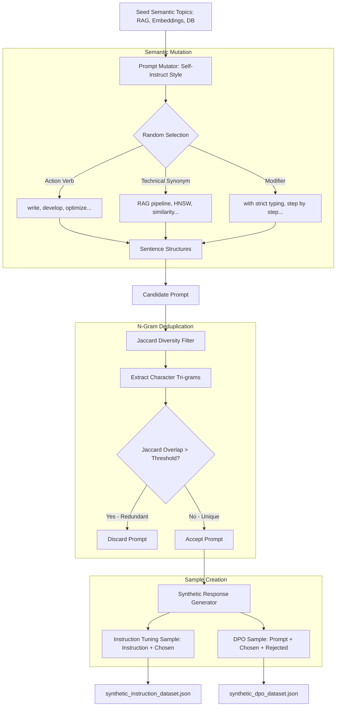

# Synthetic Data Generator

Automated engine for generating, semantically mutating, and filtering high-fidelity synthetic datasets. This module facilitates the structured creation of training data in two critical language model alignment formats: Instruction Tuning and Direct Preference Optimization (DPO).

The module solves the problem of scarce clean training data within the local infrastructure through deterministic linguistic expansion algorithms and strict duplicate control.

## Generation Methodology and Workflow

The ingestion and refinement of synthetic samples follows a multi-step architecture designed to maximize the entropy (diversity) of the final dataset.



### 1. Semantic Input Mutation (Self-Instruct Methodology)

To avoid creating datasets with homogeneous directives that induce overfitting bias in the LLM, the `SyntheticDataGenerator` module implements a linguistic mutation engine:
*   **Vocabulary Expansion:** For each seed topic (RAG, embeddings, databases), equivalent technical synonyms, action verbs, and format or style modifiers are defined.
*   **Structural Combinatorics:** The mutator pseudo-randomly combines these grammatical pieces, injecting them into directive templates (questions, code requirements, tutorial requests), producing a diversified collection of unique prompts from a small number of basic topics.

### 2. N-Gram Similarity Diversity Filter

Each generated prompt passes through a heuristic deduplication filter before being added to the final dataset:

1.  **Tri-gram Decomposition:** The candidate prompt $P_{\text{cand}}$ and each of the previously accepted prompts $P_{\text{exist}}$ are lowercased, stripped of spaces, and segmented into 3-character sequences (tri-grams). Let $G(T)$ be the set of tri-grams of text $T$.
2.  **Jaccard Coefficient:** The degree of lexical overlap is computed:
    $$J(P_{\text{cand}}, P_{\text{exist}}) = \frac{|G(P_{\text{cand}}) \cap G(P_{\text{exist}})|}{|G(P_{\text{cand}}) \cup G(P_{\text{exist}})|}$$
3.  **Threshold Cutoff:** If $J > \theta$ (where $\theta$ is the `dedup_threshold`, defaults to `0.50`), the instruction is considered semantically redundant and immediately discarded to force thematic diversity in the corpus.

### 3. DPO Preference Pair Generation

To support DPO (Direct Preference Optimization) training, the generator associates each accepted prompt with a pair of contrasted responses:

*   **Chosen Response:** Represents optimal behavior. It is a response with high technical rigor, correct data typing, free of placeholders, and with detailed theoretical explanations.
*   **Rejected Response:** Simulates anomalous or hallucinated behavior (logic errors in the code, incorrect conceptual explanations, non-existent dependencies, or empty comments).

By training an LLM with this pair of examples, the DPO loss algorithm maximizes the probability of the preferred behavior and minimizes that of the rejected one, achieving a more stable safety alignment than traditional RLHF techniques.

## Connection to the Ecosystem

This module acts as a synthetic data provider for training and evaluation:
1.  **llm-qlora-finetuner:** Directly consumes the JSON files generated by this module (`synthetic_instruction_dataset.json` and `synthetic_dpo_dataset.json`) to perform local parametric (LoRA) training of causal models.
2.  **llm-eval-harness:** Uses the high-quality instructions and response pairs to establish benchmarks and measure accuracy deviations in the LLM after fine-tuning.
3.  **dataset-version-control:** Manages change control of the generated JSON files, recording semantic differences and versioning the datasets to ensure training traceability.

## Project Structure

*   `generator.py`: Defines the `InstructionSample` and `DPOSample` Pydantic models, and the main `SyntheticDataGenerator` class with the mutator and Jaccard filters.
*   `test_generator.py`: Unit test suite that verifies the Jaccard overlap calculation, automatic deduplication, and the generated Instruction and DPO data formats.
*   `example.py`: Interactive demo run that generates 12 fine-tuning samples and DPO interactions, saving the results to disk in JSON format.

## Using it as a package

Since `0.1.0` the code lives in the `synthetic_data_generator` package and the repository is
pip-installable, so other projects can depend on it instead of copying files
or editing `sys.path`:

```bash
pip install "synthetic-data-generator @ git+https://github.com/juanmmm21/synthetic-data-generator.git@v0.1.0"
```

```python
from synthetic_data_generator import SyntheticDataGenerator, InstructionSample
```

The old top-level modules are kept as thin re-exports, so scripts that add
this folder to `sys.path` keep working. This component imports no other
ai-core component: they are combined in the `aicore` SDK of
[ai-core-infra-hub](https://github.com/juanmmm21/ai-core-infra-hub), which
passes collaborators (vector stores, encoders, tokenizers) in by injection.

Development: `pip install -e ".[dev]"`, then `pytest` and `ruff check .`.

## Installation and Usage

### 1. Activate the Local Environment and Install Dependencies

Make sure to enable the virtual environment before installing:

```bash
python3 -m venv .venv
source .venv/bin/activate
pip install -r requirements.txt
```

### 2. Run Quality Tests

```bash
.venv/bin/python -m unittest test_generator.py
```

### 3. Generate Synthetic Datasets

To run the generator and export the JSON files in the subproject:

```bash
.venv/bin/python example.py
```

The script will compile the dataset and generate the output files `synthetic_instruction_dataset.json` and `synthetic_dpo_dataset.json`, ready to be consumed by the training pipeline.
